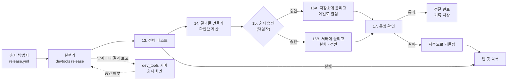

# 완성 이후: 테스트, 생성, 전달, 설치 확인

- 상태: 자동화 방식으로 변경 (2026-11-26, D-26). 사용자의 최종 점검을 기다림
- 이전 방식: 담당자가 전 과정을 손으로 수행 (D-24). 이 문서에서 자동화 가능성을 검토해 바꾸었다
- 다루는 것: 요구사항이 모두 끝나고 승인된 다음, 프로젝트를 어떻게 확인하고 만들어 내고 고객에게 전달해 운영까지 확인하는가

## 1. 결론

**자동화할 수 있다. 사람이 손으로 하던 일을 "출시 방법서"라는 실행할 수 있는 파일로 옮기고, 실행기가 그대로 수행한다. 사람은 승인하고, 자동으로 확인할 수 없는 것만 직접 본다.**

1. 전체 테스트, 결과물 만들기, 가공, 클라우드 저장소 올리기, 메일 보내기, 고객 서버 설치, 운영 확인, 되돌리기는 모두 명령으로 실행할 수 있다.
2. 실행은 **담당자의 컴퓨터**나 **CI**에서 돈다. dev_tools 서버는 실행하지 않고 고객의 접속 정보도 갖지 않는다. 이 원칙은 그대로다.
3. 사람이 남는 곳은 세 군데다. 출시 승인, 눈으로 봐야 하는 확인, 고객과의 소통.
4. 자동화할 수 없는 환경(고객이 자동 접속을 금지하는 경우 등)에서는 같은 방법서를 점검표로 삼아 손으로 수행한다. 수동은 없어지지 않고 예비 수단이 된다.

## 2. 단계별 자동화 가능성

| 단계 | 하는 일 | 자동화 | 방법 | 사람이 남는 부분 |
|---|---|---|---|---|
| 13 함께 확인 | 모두 합친 상태에서 전체 테스트 | 가능 | 테스트 명령 실행, 결과 수집 | 없음 |
| 14 결과물 만들기 | 빌드, 묶기, 확인값 계산 | 가능 | 빌드 명령 실행. 깨끗한 환경(CI나 컨테이너)에서 돌리면 누가 해도 같은 결과 | 없음 |
| 14 가공 | 고객이 원하는 형식으로 변환 | 가능 | 형식마다 명령으로 정의(압축, 설치 묶음, 이미지) | 처음 한 번 형식을 정하는 일 |
| 전달 문서 | 바뀐 점, 요구사항 확인서 | 가능 | dev_tools의 기록에서 생성 | 고객에게 보내는 글 다듬기(선택) |
| 15 출시 승인 | 내보내도 되는지 결정 | **하지 않음** | - | 책임자가 누른다. "사람이 결정한다"는 원칙 |
| 16A 클라우드 저장소 | 결과물과 문서를 올림 | 가능 | 저장소의 명령줄 도구나 API. 올린 뒤 확인값을 다시 대조 | 없음 |
| 16A 메일 | 고객에게 알림 | 가능 | 메일 서버나 발송 서비스. 큰 파일은 첨부하지 않고 내려받기 주소와 확인값을 보냄 | 받는 사람을 처음 한 번 등록 |
| 16B 서버 설치 | SSH로 접속해 설치 | 가능 | SSH로 파일을 올리고 설치 명령을 실행. 이전 버전을 남겨 두고 새 버전으로 전환 | 접속 권한을 가진 사람의 컴퓨터에서 실행 |
| 17 운영 확인 | 잘 도는지 테스트 | 대부분 가능 | 서비스 상태, 접속, 주요 기능 호출, 재시작 뒤 자동 실행, 로그의 오류 검사 | 화면을 눈으로 봐야 하는 항목 |
| 되돌리기 | 실패 시 이전 버전으로 | 가능 | 운영 확인이 실패하면 자동으로 전환을 되돌림 | 되돌린 뒤의 판단 |
| 전달 기록 | 누가, 언제, 무엇을, 어디에 | 가능 | 실행기가 단계마다 dev_tools에 보고 | 없음 |
| 고객 의견 | 받은 의견을 다음 일로 | 하지 않음 | - | 담당자가 새 할 일로 등록 |

자동화를 막는 것은 기술이 아니라 **접속 권한이 어디에 있는가**와 **고객의 보안 정책**이다. 다음 장에서 이 문제를 다룬다.

## 3. 누가 실행하는가

자동화의 가장 중요한 결정이다. 세 가지를 비교했다.

| 실행 위치 | 내용 | 장점 | 단점 | 판단 |
|---|---|---|---|---|
| dev_tools 서버 | 서버가 고객 서버에 직접 접속해 설치 | 버튼 하나로 끝남 | 서버가 모든 고객의 접속 열쇠를 가져야 함. 서버가 뚫리면 모든 고객이 위험. 고객의 사설망·VPN에 닿지 못함 | 채택하지 않음 |
| CI | GitHub Actions 등이 실행 | 깨끗한 환경, 누가 해도 같은 결과, 기록이 남음 | 고객의 사설망에 닿으려면 고객 망 안에 실행 서버를 둬야 함. 열쇠를 CI의 비밀 저장소에 넣어야 함 | 빌드와 테스트에 권장. 전달은 닿을 수 있을 때만 |
| **담당자의 컴퓨터** | 담당자가 명령 하나를 실행하면 그 컴퓨터에서 돈다 | 담당자가 이미 가진 VPN과 SSH 열쇠를 그대로 씀. 열쇠를 어디에도 옮기지 않음. 어떤 고객 환경에도 닿음 | 담당자의 컴퓨터 환경에 따라 결과물이 달라질 수 있음 | **전달과 설치의 기본** |

**권장 구성**은 둘을 나누는 것이다.

- **만들기(13, 14단계)는 깨끗한 환경에서.** CI가 있으면 CI에서, 없으면 담당자 컴퓨터의 컨테이너 안에서 실행한다. 결과물과 확인값이 나온다.
- **전달과 설치(16, 17단계)는 담당자의 컴퓨터에서.** 만들어진 결과물을 확인값으로 대조한 뒤, 담당자의 접속 권한으로 올리고 설치하고 확인한다.

이 구성은 dev_tools가 이미 쓰는 방식과 같다. 활동 수집도 서버가 개발자 컴퓨터에 들어가지 않고, 개발자 컴퓨터의 작은 프로그램이 서버에 알려 준다. 출시도 똑같이, 담당자 컴퓨터의 실행기가 일을 하고 서버에 결과를 알려 준다.

## 4. 동작 방식



1. 담당자가 전달을 맡고 자기 컴퓨터에서 `devtools release run 1.0 --target 고객A`를 실행한다.
2. 실행기가 출시 방법서를 읽어 단계를 순서대로 실행하고, 단계마다 성공 여부와 걸린 시간을 dev_tools에 보고한다. 팀 화면에 진행이 실시간으로 보인다.
3. 결과물이 만들어지면 실행기는 **멈춰서 출시 승인을 기다린다.** 책임자가 화면에서 승인하면 이어서 진행한다.
4. 올리고, 설치하고, 운영 확인을 돌린다. 눈으로 봐야 하는 항목이 있으면 그 자리에서 담당자에게 묻는다.
5. 모두 통과하면 전달 기록이 저장되고 전달이 끝난다. 실패하면 자동으로 이전 버전으로 되돌리고, 무엇이 실패했는지 기록한다.

## 5. 출시 방법서

프로젝트 저장소에 두는 파일이다. 사람이 읽을 수 있고 실행기가 그대로 실행한다. 아래는 형식을 보여 주는 예시다.

```yaml
# release.yml (예시)
version_from: package.json

verify:                         # 13단계
  - name: 전체 테스트
    run: npm test
  - name: 화면 시나리오
    run: npm run test:e2e

build:                          # 14단계
  in: container                 # 깨끗한 환경에서 실행 (ci | container | local)
  run: npm run build && npm run package
  artifacts:
    - path: dist/app-${VERSION}.tar.gz

targets:
  고객A:
    approval: required          # 15단계: 책임자의 승인을 기다림
    deliver:
      - upload:                 # 16A: 클라우드 저장소
          to: ${CUSTOMER_A_BUCKET}/releases/${VERSION}/
          include: [artifacts, handoff]
      - notify:                 # 16A: 메일
          to: ${CUSTOMER_A_CONTACTS}
          template: release-notice
      - install:                # 16B: 서버 직접 설치
          host: ${CUSTOMER_A_HOST}      # 값은 담당자 컴퓨터의 환경에서 읽음
          steps:
            - backup: /opt/app/current
            - copy: artifacts -> /opt/app/releases/${VERSION}/
            - run: /opt/app/releases/${VERSION}/install.sh
            - switch: /opt/app/current -> /opt/app/releases/${VERSION}
            - run: sudo systemctl restart app
    check:                      # 17단계
      - name: 서비스가 떠 있다
        remote: systemctl is-active app
      - name: 접속된다
        http: ${CUSTOMER_A_URL}/health
        expect: 200
      - name: 다시 켜도 자동으로 뜬다
        remote: systemctl is-enabled app
      - name: 로그에 오류가 없다
        remote: "! journalctl -u app --since '-5min' | grep -i error"
      - name: 첫 화면이 제대로 보인다
        manual: true            # 담당자가 눈으로 확인
    rollback:
      - switch: /opt/app/current -> previous
      - run: sudo systemctl restart app
```

규칙은 다음과 같다.

- **비밀 값은 파일에 쓰지 않는다.** 서버 주소, 계정, 저장소 위치, 메일 주소는 `${이름}`으로만 적고, 값은 실행하는 컴퓨터의 환경에서 읽는다. dev_tools 서버에는 "고객A"라는 이름만 남는다.
- **자동으로 못 하는 확인은 `manual: true`로 적는다.** 실행기가 멈추고 담당자에게 묻는다.
- **형태마다 다른 것은 모두 이 파일에 있다.** dev_tools와 실행기는 형태를 모른다. 명령을 실행하고 결과를 기록할 뿐이다.
- **수동으로 할 때도 같은 파일을 쓴다.** `devtools release run --manual`은 명령을 실행하지 않고 단계를 하나씩 보여 주며 담당자가 표시하게 한다.

AI 개발툴에게 "이 프로젝트의 출시 방법서를 만들어 줘"라고 시켜 초안을 받을 수 있다. 자주 쓰는 형태에는 본보기 파일을 제공한다.

## 6. 안전장치

고객의 운영 서버를 다루므로 자동화는 조심스럽게 한다.

| 장치 | 내용 |
|---|---|
| 미리 해 보기 | `--dry-run`은 아무것도 바꾸지 않고 무엇을 할지 순서대로 보여 준다. 처음 쓰는 대상에는 필수 |
| 승인 대기 | 고객에게 닿는 단계 앞에서 반드시 멈춘다. 승인 없이 넘어가는 설정은 두지 않는다 |
| 확인값 대조 | 만든 결과물과 올린 결과물, 설치한 결과물의 확인값이 같은지 단계마다 검사한다 |
| 이전 버전 보존 | 새 버전을 다른 폴더에 설치하고 전환한다. 이전 버전을 지우지 않는다 |
| 자동 되돌리기 | 운영 확인이 실패하면 전환을 되돌린다 |
| 한 번에 한 사람 | 같은 대상에 대한 전달은 한 사람만 맡을 수 있다. 기존 "맡기"와 같은 방식 |
| 기록 가리기 | 실행기는 보고하기 전에 환경에서 읽은 값을 기록에서 지운다 |
| 정해진 명령만 | 실행기는 방법서에 적힌 것만 실행한다. AI 개발툴이 고객 서버에서 즉석으로 명령을 만들어 실행하게 하지 않는다 |

마지막 항목은 의도한 제한이다. AI 개발툴은 방법서를 쓰고 고치는 일과 실패 원인을 살피는 일을 돕는다. 고객 서버에서 실제로 실행되는 것은 사람이 미리 검토한 방법서다.

## 7. 자동화 수준

프로젝트와 고객에 따라 고른다. 대상(`targets`)마다 다르게 정할 수 있다.

| 수준 | 내용 | 쓰는 때 |
|---|---|---|
| 0. 수동 | 방법서를 점검표로 보고 담당자가 손으로 수행 | 고객이 자동 접속을 허용하지 않을 때. 처음 한두 번 |
| 1. 만들기만 자동 | 테스트, 결과물, 문서까지 자동. 전달과 설치는 손으로 | 고객 서버의 절차가 아직 정리되지 않았을 때 |
| **2. 승인 뒤 자동** | 승인하면 전달, 설치, 운영 확인, 되돌리기까지 자동 | **기본 권장** |
| 3. 승인 없이 자동 | 사람의 승인 없이 끝까지 | 제공하지 않음. "사람이 결정한다"는 원칙에 어긋남 |

처음에는 수준 0이나 1로 한두 번 해 보며 방법서를 다듬고, 절차가 안정되면 수준 2로 올리는 것을 권한다.

## 8. 형태별로 다른 점

| 형태 | 결과물 | 전달 | 자동 운영 확인 | 자동화가 어려운 부분 |
|---|---|---|---|---|
| 웹 서비스 | 컨테이너 이미지, 압축 파일 | 서버 설치 | 상태, 접속, 주요 기능 호출 | 화면의 모양 |
| 고객 서버용 프로그램 | 설치 묶음 | 서버 설치 | 설치, 기동, 재시작, 로그 | 고객 망의 접속 제한 |
| 데스크톱 프로그램 | 운영체제별 설치 파일 | 저장소와 메일 | 깨끗한 가상 컴퓨터에서 설치와 실행 | 코드 서명 열쇠의 보관, 운영체제의 공증 대기 |
| 모바일 앱 | 앱 묶음 | 앱 장터 또는 저장소 | 모의 기기에서 실행 | 장터 심사는 사람이 기다려야 함 |
| 라이브러리 · SDK | 패키지 | 패키지 저장소 또는 저장소와 메일 | 사용 예제 빌드와 실행 | 없음 |
| 명령줄 도구 | 실행 파일 | 저장소와 메일 | 운영체제별 실행 | 없음 |
| 기기용 소프트웨어 | 펌웨어 이미지 | 저장소와 메일 | 모의 장치 시험 | 실제 기기에 올리는 일과 확인 |
| 데이터 · AI 모델 | 모델 파일 | 저장소와 메일 | 평가 점수, 불러오기 | 없음 |

## 9. 출시 화면

| 구역 | 보여 주는 것 |
|---|---|
| 이번 버전 | 목표 버전에 묶인 요구사항 중 끝난 수와 남은 수 |
| 담당자 | 이번 전달을 맡은 사람. 비어 있으면 "내가 맡기" |
| 진행 | 방법서의 단계가 순서대로 나열되고, 실행기가 보고한 상태(기다림, 도는 중, 통과, 실패)와 걸린 시간이 실시간으로 표시됨 |
| 출시 승인 | 실행기가 승인을 기다릴 때 책임자에게 버튼이 나타남. 테스트 결과와 결과물 정보를 함께 보여 줌 |
| 대상 | 대상별로 지금 전달돼 있는 버전과 마지막 전달 일시 |
| 전달 묶음 | 바뀐 점과 요구사항 확인서 내려받기 |
| 실패했을 때 | 어느 단계에서 왜 실패했는지, 되돌렸는지 |

화면에는 명령을 시작하는 버튼이 없다. 시작은 담당자가 자기 컴퓨터에서 한다. 화면은 지켜보고 승인하는 곳이다.

## 10. 전달 묶음과 기록

### 전달 묶음

| 구성 | 내용 | 만드는 방법 |
|---|---|---|
| 결과물 | 설치 파일, 압축 파일, 이미지 | 실행기 |
| 확인값 | 결과물이 바뀌지 않았음을 대조하는 값 | 실행기 |
| 바뀐 점 | 이번 버전에서 새로 생기거나 고쳐진 것 | 요구사항에서 자동 생성 |
| 요구사항 확인서 | 요구사항마다 충족 여부, 확인한 테스트, 승인한 사람 | 기록에서 자동 생성 |
| 운영 확인 결과 | 수행한 확인과 결과 | 실행기의 보고에서 자동 생성 |
| 설치와 사용 안내 | 설치 방법, 시작하는 법 | 사람이 한 번 쓰고 저장소에 둠 |

### 전달 기록

실행기가 자동으로 채운다. 버전과 커밋, 담당자, 승인자, 대상의 이름, 경로, 결과물의 확인값, 단계별 결과와 시간, 운영 확인 결과가 남는다.

### 기록하지 않는 것

- 고객 서버의 주소, 계정, 비밀번호, SSH 열쇠, 저장소의 접근 열쇠
- 고객의 메일 주소
- 명령의 전체 출력. 실패한 단계의 마지막 몇 줄만, 비밀 값을 가린 뒤 남긴다

## 11. 전달 뒤

- 고객의 의견과 운영 중 발견된 문제는 담당자가 새 할 일로 등록한다. 빈 곳 목록에 들어가 처음 흐름으로 돌아간다.
- 급한 고침은 요구사항 하나짜리 버전으로 같은 길을 지나간다. 방법서가 있으므로 빠르다.
- 요구사항에 **목표 버전**을 붙여 버전 단위로 전달한다. 마지막에 한꺼번에 내보내지 않는다.

## 12. 만들어야 하는 것

| 구성요소 | 내용 |
|---|---|
| 방법서 읽기와 검사 | `release.yml`의 형식을 검사하고 잘못된 곳을 알려 줌 |
| 실행기 | `devtools release run`, `--dry-run`, `--manual`, `rollback`. 단계 실행, 승인 대기, 확인값 대조, 자동 되돌리기, 기록 가리기 |
| 단계 종류 | 명령 실행, 저장소 올리기, 메일 알림, SSH 복사·실행·전환, HTTP 확인, 원격 확인, 수동 확인 |
| 서버 | 출시와 실행 기록 저장, 승인 처리, 실시간 전송 |
| 출시 화면 | 9장의 화면 |
| 문서 생성 | 바뀐 점, 요구사항 확인서, 운영 확인 결과 |
| 본보기 방법서 | 웹 서비스, 고객 서버용 프로그램 |

실행기는 연결 명령(`devtools connect`)과 같은 프로그램에 들어간다. 담당자 컴퓨터에서도 CI에서도 같은 명령으로 돈다.

## 13. 개발 계획에 넣는 방법

기존 6단계(3주)를 두 단계로 나눈다.

| 단계 | 이름 | 내용 | 기간(추정) |
|---|---|---|---|
| 6 | 출시 준비와 만들기 자동화 | 목표 버전, 방법서 형식과 검사, 실행기의 테스트·빌드 단계와 `--dry-run`, 출시 화면, 출시 승인, 문서 생성 | 3주 |
| 7 | 전달과 설치 자동화 | 저장소 올리기, 메일 알림, SSH 설치와 전환, 운영 확인, 자동 되돌리기, `--manual`, 전달 기록, 본보기 방법서 | 3주 |

6단계가 끝나면 자동화 수준 1을, 7단계가 끝나면 수준 2를 쓸 수 있다. dev_tools 자체의 전달을 첫 시험 대상으로 삼는다(`webapp/release.yml`).

## 14. 위험

| 위험 | 대응 |
|---|---|
| 자동 설치가 고객의 운영 서버를 망가뜨림 | 미리 해 보기, 이전 버전 보존, 자동 되돌리기, 처음에는 수준 0이나 1 |
| 비밀 값이 기록에 남음 | 파일에는 이름만. 실행기가 보고 전에 가림 |
| 고객이 자동 접속을 허용하지 않음 | 대상별로 수준 0을 선택 |
| 담당자의 컴퓨터마다 결과가 다름 | 만들기는 컨테이너나 CI에서. 전달 전에 확인값 대조 |
| 방법서 작성이 부담 | 본보기 파일, AI 개발툴로 초안 작성, 수준 0부터 점차 자동화 |
| 중간에 실패해 반쯤 설치된 상태 | 전환 단계 전까지는 운영 중인 버전을 건드리지 않음 |
| 되돌릴 수 없는 변경(데이터 구조 변경 등) | 방법서에 "되돌릴 수 없음"을 표시하게 하고, 그 단계 앞에서 한 번 더 확인을 받음 |

## 15. 남은 질문

1. 처음 지원할 클라우드 저장소와 메일 발송 방법 (지금은 S3 호환 저장소와 SMTP로 가정)
2. 출시 승인자를 책임자 한 명으로 할지 (지금은 한 명으로 가정)
3. CI를 쓰는 경우 처음 지원할 도구 (지금은 GitHub Actions로 가정)
4. 실행기를 Windows에서도 지원할지 (지금은 macOS와 Linux로 가정)
