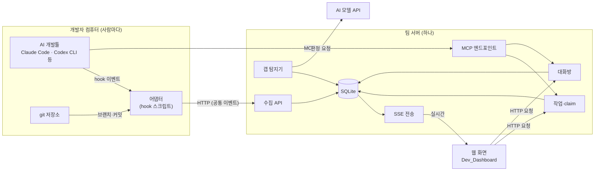
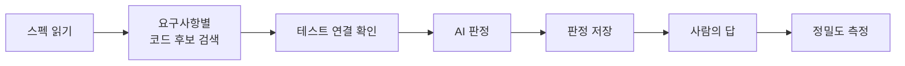

# 기술 설계서

- 상태: 초안 (2026-11-26)
- 근거: `dev_tools_definition.md`, `docs/requirements.md`, `docs/decisions.md`, `research.md`

> 이 문서는 구현 전에 쓴 설계에서 출발했다. 9장(어댑터)은 실제 도구에서 확인한 내용으로 고쳤다. 아직 확인하지 못한 항목은 19장에 있다.

## 1. 전체 구성



- 개발자 컴퓨터에는 어댑터(작은 스크립트)와 설정만 설치된다. 상주 프로그램은 두지 않는다.
- 팀 서버는 프로세스 하나와 데이터베이스 파일 하나다.
- AI 개발툴은 서버와 두 경로로 이어진다. hook으로 활동을 보내고, MCP로 기능을 호출한다.

## 2. 기술 선택

| 영역 | 선택 | 상태 | 이유 |
|---|---|---|---|
| 언어 | TypeScript | 확정 (D-09) | 서버·화면·어댑터를 한 언어로 |
| 서버 실행 환경 | Node.js LTS | 확정 (D-09) | MCP 공식 SDK 지원 |
| 저장소 | SQLite | 확정 (D-09) | 설치가 필요 없고 팀 하나에 충분 |
| 화면 | React | 확정 (D-09) | 일반적인 선택 |
| 실시간 전송 | SSE | 확정 (D-09) | 읽기 전용 피드에 적합. 재연결과 이어 받기가 표준에 있음 |
| 저장소 구조 | npm 워크스페이스 | 적용 (T-01) | 공통 타입을 패키지로 공유. 추가 설치가 필요 없음 |
| 서버 프레임워크 | Fastify 5 | 적용 (T-02) | |
| DB 접근 | better-sqlite3, SQL 직접 작성 | 적용 (T-03) | 동기식 트랜잭션으로 claim 구현이 단순해짐 |
| 입력 검증 | zod 4 | 적용 (T-09) | 공통 이벤트 형식을 스키마로 정의 |
| 비밀번호 | argon2id | 적용 (T-08) | |
| 화면 빌드 | Vite 7 | 적용 (T-04) | |
| 테스트 | Vitest | 적용 (T-05) | 화면 테스트용 Playwright는 아직 없음 |
| 코드 검사 | ESLint, Prettier | 예정 (T-06) | |
| MCP | `@modelcontextprotocol/sdk` | 예정 | 공식 SDK. 2단계 |

정확한 버전은 `webapp/package-lock.json`에 고정돼 있다.

## 3. 저장소 구조

```
dev_tools/
├── webapp/                  제품 코드 전체. 이 폴더만으로 빌드하고 배포한다
│   ├── apps/
│   │   ├── server/          서버 (수집, claim, 갭 탐지, 대화방, MCP, SSE)
│   │   └── web/             Dev_Dashboard 화면
│   ├── packages/
│   │   ├── shared/          공통 이벤트 형식, 타입, 상태 계산 규칙
│   │   ├── adapters/        도구별 변환 함수와 실제 도구에서 받은 표본 (claude-code, codex, ...)
│   │   └── cli/             devtools 명령 (connect, disconnect, status, hook. release는 6단계)
│   ├── spec/                dev_tools 자체의 스펙 (요구사항)
│   ├── eval/                갭 탐지 평가셋과 측정 스크립트
│   ├── Dockerfile, docker-compose.yml
│   └── README.md            실행과 배포 방법
├── docs/                    문서
└── (루트 문서들)
```

제품 코드는 모두 `webapp/` 안에 있고 그 폴더만으로 빌드하고 배포한다(D-27). `spec`, `eval`은 아직 만들지 않았다.

서버와 화면은 `packages/shared`의 타입만 공유한다. 어댑터와 `cli`는 서버 코드를 참조하지 않는다(REQ-NFR-006). `adapters`는 입출력이 없는 변환 함수만 두고, 파일·git·네트워크는 `cli`가 맡는다. `cli`는 빌드하면 의존성을 모두 묶은 파일 하나(`dist/devtools.mjs`)가 되고, 서버가 이 파일을 내려준다.

## 4. 공통 이벤트 형식

모든 어댑터는 도구의 이벤트를 아래 형식으로 바꿔 보낸다.

| 필드 | 타입 | 설명 |
|---|---|---|
| `id` | 문자열 | 어댑터가 만든 고유 값. 같은 이벤트가 두 번 와도 한 번만 저장 |
| `project` | 문자열 | 프로젝트 식별자 |
| `member` | 문자열 | 팀원 식별자 (컴퓨터용 토큰에서 결정. 본문 값은 무시) |
| `tool` | 문자열 | `claude-code`, `codex`, `kimi`, `gemini`, `git` |
| `session` | 문자열 | 도구가 준 세션 ID |
| `kind` | 문자열 | 아래 표의 종류 |
| `at` | 시각 | 일어난 시각 (ISO 8601) |
| `cwd` | 문자열 | 작업 디렉터리. 저장소 루트 기준 상대 경로로 바꿔 저장 |
| `branch` | 문자열 | 현재 브랜치 |
| `data` | 객체 | 종류별 추가 정보 |

| `kind` | 뜻 | `data` |
|---|---|---|
| `session.start` | 세션 시작 | 도구 버전 |
| `session.end` | 세션 종료 | 종료 이유 |
| `session.idle` | 사용자 입력을 기다림 | - |
| `turn.start` | 사용자가 지시를 보냄 | 본문은 설정을 켰을 때만 |
| `turn.end` | AI가 응답을 마침 | - |
| `file.change` | 파일을 만들거나 고침 | 경로 목록 |
| `command.run` | 명령을 실행함 | 명령 종류(테스트, 빌드, 기타), 성공 여부 |
| `test.result` | 테스트 결과 | 통과·실패 수, 실패한 테스트 이름, 요구사항 ID 목록 |
| `git.commit` | 커밋이 생김 | 해시, 제목, 바뀐 경로 |
| `git.branch` | 브랜치가 바뀜 | 이전·이후 브랜치 |

- 기본 설정에서 프롬프트, 응답, 파일 내용, 명령의 전체 문자열은 보내지 않는다(REQ-COL-006).
- `test.result`는 어댑터가 테스트 실행기의 요약 출력을 읽어 만든다. 지원할 실행기는 1단계에서 팀이 쓰는 것부터 정한다.

## 5. 데이터 모델

| 테이블 | 주요 필드 | 설명 |
|---|---|---|
| `projects` | id, name, repo_url, settings | 프로젝트. 첫 버전은 하나 |
| `members` | id, project_id, login_id, name, password_hash, roles, active, status_note, last_seen_at | 팀원. `status_note`가 한마디. `active`가 꺼지면 쉬는 상태 |
| `device_tokens` | id, member_id, label, token_hash, created_at, last_used_at, revoked_at | 연결 명령이 받은 컴퓨터용 토큰 |
| `web_sessions` | id, member_id, created_at, expires_at | 화면 로그인 |
| `sessions` | id, member_id, tool, started_at, ended_at, last_event_at, branch, claim_id | AI 개발툴 세션 |
| `events` | seq, id, session_id, member_id, kind, at, data | 활동 기록. `seq`는 서버가 매긴 순번 |
| `requirements` | id, title, body, area, priority, source, depends_on, spec_path | 요구사항. `source`는 스펙 파일 또는 화면 등록 |
| `assessments` | id, requirement_id, verdict, confidence, evidence, commit, model, cost, created_at, human_answer, answered_by | AI 판정과 사람의 답 |
| `claims` | id, requirement_id, member_id, state, claimed_at, last_activity_at, expires_at, ended_reason | 맡기 기록 |
| `approvals` | id, claim_id, requested_at, approved_by, approved_at | 완료 승인 |
| `test_links` | requirement_id, test_name, last_result, last_run_at | 요구사항과 테스트의 연결 |
| `overlaps` | id, path, member_a, member_b, detected_at, resolved_at | 파일 겹침 |
| `messages` | id, member_id, body, is_notice, requirement_id, created_at | 대화방의 말. `requirement_id`가 붙인 일 |
| `message_reads` | member_id, last_read_message_id | 안 읽은 수 계산 |
| `notice_acks` | message_id, member_id | 공지 확인 |
| `notifications` | id, member_id, kind, ref, created_at, seen_at | 알림 |
| `releases` | id, version, state, artifact_name, artifact_checksum, commit, approved_by, approved_at | 출시. `requirements`에 `target_version` 필드를 더해 묶음 |
| `release_runs` | id, release_id, target_label, owner_member_id, mode, state, started_at, ended_at | 대상 하나에 대한 실행 한 번. `mode`는 자동, 수동, 미리 해 보기 |
| `release_steps` | run_id, position, section, name, kind, state, duration_ms, log_tail | 실행기가 보고한 단계. `log_tail`은 비밀 값을 가린 마지막 몇 줄 |
| `deliveries` | id, run_id, route, target_label, done_at, rolled_back | 전달 기록. 고객 서버의 주소·계정·열쇠는 넣지 않음 |

### 상태 계산

화면에 보이는 일의 상태는 저장하지 않고 두 축에서 계산한다. 계산 규칙은 `packages/shared`에 한 번만 둔다.

| 화면의 상태 | 조건 |
|---|---|
| 끝남 | 승인된 claim이 있음 |
| 확인 중 | 진행 중인 claim이 있고 완료를 요청함 |
| 만드는 중 | 진행 중인 claim이 있음 |
| 아직 못 함 | claim이 없고, 먼저 끝나야 하는 요구사항이 끝나지 않음 |
| 비어 있음 | claim이 없고, 구현 상태가 없음 또는 부분 구현 |
| (목록에 없음) | claim이 없고, 구현 상태가 구현됨 |

구현 상태는 사람의 답이 있으면 그것을, 없으면 가장 최근의 AI 판정을 쓴다. 3단계 전에는 화면에서 등록한 일을 모두 "없음"으로 본다.

## 6. Claim 규칙

### 맡기

`claims` 테이블에 "요구사항 하나에 진행 중인 claim은 하나"라는 유일 조건을 건다. 맡기는 행을 하나 넣는 일이고, 두 요청이 동시에 오면 데이터베이스가 하나를 거절한다(REQ-TSK-003). 거절된 쪽에는 누가 먼저 맡았는지를 알려 준다.

### 활동과 만료

- 맡은 사람의 세션에서 이벤트가 오면 `last_activity_at`과 `expires_at`을 갱신한다(REQ-TSK-004).
- 한 사람이 일을 하나만 맡고 있으면 그 사람의 모든 세션 활동을 그 일의 활동으로 본다.
- 여러 개를 맡고 있으면 세션에 연결된 claim만 갱신한다. 연결은 MCP로 맡았을 때 자동으로 생기고(REQ-MCP-007), 웹에서 맡았을 때는 브랜치 이름에 들어 있는 요구사항 ID로 찾는다.
- 서버는 1분마다 만료 시각이 지난 claim을 풀고, 만료 전 알림 시점이 된 claim에 알림을 만든다.
- 만료 시간과 알림 시점은 프로젝트 설정이며 잠정값은 60분과 10분 전이다(O-03).

### 상태 변화

| 변화 | 일으키는 것 |
|---|---|
| (없음) → 진행 중 | 사람이 맡음 |
| 진행 중 → 완료 요청 | 사람이 "끝났어요"를 누름. 연결된 테스트가 모두 통과해야 함 |
| 완료 요청 → 승인됨 | 다른 팀원이 확인함 |
| 완료 요청 → 진행 중 | 다른 팀원이 돌려보냄, 또는 테스트가 다시 실패함 |
| 진행 중 → 풀림 | 사람이 놓음, 또는 만료됨 |

## 7. 서버 API

화면은 로그인 뒤 받은 쿠키로, 어댑터와 MCP는 `Authorization: Bearer <컴퓨터용 토큰>`으로 인증한다. 로그인 요청을 뺀 모든 요청에 인증이 필요하다(REQ-NFR-003).

| 방식 | 경로 | 설명 |
|---|---|---|
| POST | `/api/events` | 이벤트 수집 (여러 개를 한 번에) |
| GET | `/api/stream` | SSE 실시간 전송 |
| GET | `/api/snapshot` | 화면을 처음 그릴 때 쓰는 전체 상태 |
| GET | `/api/requirements` | 일 목록 (필터: 상태, 급함, 오래됨, 바로 시작 가능) |
| POST | `/api/requirements` | 일을 직접 등록 |
| GET | `/api/requirements/:id` | 일의 자세한 내용, 판정, 근거, 붙은 대화 |
| PATCH | `/api/requirements/:id` | 우선순위 변경 |
| POST | `/api/requirements/:id/claim` | 맡기 |
| POST | `/api/claims/:id/release` | 놓기 |
| POST | `/api/claims/:id/request-approval` | 완료 요청 |
| POST | `/api/claims/:id/approve` | 완료 승인 |
| POST | `/api/claims/:id/return` | 돌려보내기 |
| POST | `/api/assessments/:id/answer` | 갭 후보에 대한 사람의 답 |
| POST | `/api/gaps/scan` | 갭 탐지 실행 |
| GET | `/api/messages` | 대화 목록 (필터: 요구사항) |
| POST | `/api/messages` | 말 보내기 (공지 여부, 붙일 일) |
| POST | `/api/messages/:id/ack` | 공지 확인 |
| PUT | `/api/me/status` | 한마디 바꾸기 |
| GET | `/api/me/work` | 내가 맡은 일 |
| POST | `/api/login` | ID와 비밀번호로 로그인 |
| POST | `/api/logout` | 로그아웃 |
| POST | `/api/device-tokens` | 연결 명령용. ID와 비밀번호로 컴퓨터용 토큰 발급 |
| GET, DELETE | `/api/me/device-tokens` | 내 컴퓨터용 토큰 목록과 끊기 |
| DELETE | `/api/device-tokens/self` | 연결 해제 명령용. 요청에 쓴 컴퓨터용 토큰을 폐기 |
| GET | `/devtools.mjs` | 연결 명령 파일 내려받기 (로그인 없이. 비밀 값 없음) |
| PUT | `/api/me/password` | 비밀번호 바꾸기 |
| GET, POST | `/api/members` | 팀원 목록, 추가 (관리자) |
| PATCH | `/api/members/:id` | 역할 변경, 쉬게 하기, 임시 비밀번호 발급 (관리자) |
| GET, POST | `/api/releases` | 출시 목록, 만들기 |
| POST | `/api/releases/:id/claim` | 전달 맡기 |
| POST | `/api/releases/:id/runs` | 실행 시작을 등록 (실행기) |
| POST | `/api/release-runs/:id/steps` | 단계의 상태 보고 (실행기) |
| GET | `/api/release-runs/:id/approval` | 승인됐는지 확인 (실행기) |
| POST | `/api/releases/:id/approve` | 출시 승인 (책임자) |
| GET | `/api/releases/:id/handoff` | 바뀐 점과 요구사항 확인서 초안 |
| GET | `/api/metrics` | 측정 항목 (정밀도, 만료 비율 등) |

### 실시간 전송

- 화면은 먼저 `/api/snapshot`으로 전체 상태를 받고, `/api/stream`으로 변경분을 받는다.
- 각 SSE 메시지에는 순번이 붙는다. 다시 연결할 때 `Last-Event-ID`를 보내면 그 뒤의 변경만 받는다(REQ-NFR-005).
- 보내는 것은 원본 이벤트가 아니라 화면에 필요한 변경(팀원 줄, 일 상태, 대화, 알림)이다. 파일 수정 같은 잦은 이벤트는 팀원 줄의 갱신으로 묶어 1초에 한 번을 넘지 않게 보낸다.

## 8. MCP 도구

서버가 `/mcp`에서 HTTP 방식의 MCP 엔드포인트를 제공한다. 원격 MCP를 쓸 수 없는 도구를 위해 `packages/cli`에 같은 일을 하는 로컬 중계 명령을 둔다.

| 도구 이름 | 하는 일 | 요구사항 |
|---|---|---|
| `list_open_work` | 비어 있는 일 목록 | REQ-MCP-001 |
| `get_work` | 일의 자세한 내용과 근거 | REQ-MCP-001 |
| `claim_work` | 일을 맡음. 겹칠 수 있는 작업을 함께 돌려줌 | REQ-MCP-002, 005 |
| `release_work` | 맡은 일을 놓음 | REQ-MCP-003 |
| `my_work` | 내가 맡은 일과 상태 | REQ-MCP-004 |
| `post_message` | 대화방에 말을 남김 | REQ-MCP-006 |

`claim_work`와 `post_message`의 설명에는 "사용자가 분명히 지시했을 때만 호출한다"고 적는다. 이것은 AI 개발툴에 대한 안내일 뿐 기술적으로 막는 장치는 아니다. 각 도구의 권한 확인 기능으로 호출 전에 사람에게 묻도록 설정하는 방법을 설치 안내에 넣는다.

## 9. 어댑터

두 도구 모두 command hook이 `devtools hook <도구>`를 실행하고, 변환은 개발자 컴퓨터에서 한다(D-28). 도구가 hook에 넘기는 JSON에는 프롬프트 원문, 파일 내용, AI의 마지막 응답이 들어 있다(Claude Code 2.1.332에서 확인). 이것을 서버로 그대로 보내면 공통 형식이 걸러 주더라도 원문이 컴퓨터 밖으로 나간다. 그래서 서버 쪽 변환 경로는 두지 않는다.

| | Claude Code | Codex CLI |
|---|---|---|
| 확인한 버전 | 2.1.332 (모든 이벤트를 실제로 받음) | 0.166.0 (세션 시작·종료와 지시는 실제로 받음. 도구 이벤트는 내장 스키마 기준 **[미확인]**) |
| 설정 위치 | 프로젝트의 `.claude/settings.local.json` (개인 파일. git에 올리지 않게 `.git/info/exclude`에 넣음) | 사용자의 `~/.codex/hooks.json` (`CODEX_HOME`을 따름) |
| 세션 시작·종료 | `SessionStart`, `SessionEnd` | `SessionStart`, `SessionEnd` |
| 지시와 응답 | `UserPromptSubmit` → `turn.start`, `Stop` → `turn.end` | `UserPromptSubmit`, `Stop`, `Interrupt` |
| 입력을 기다림 | `Notification` → `session.idle` | `PermissionRequest` → `session.idle` |
| 파일 변경 | `PostToolUse`의 `Write`, `Edit`, `MultiEdit`, `NotebookEdit` | 턴 시작과 끝의 `git status` 비교. `apply_patch` 본문이 오면 그 경로도 읽음 |
| 명령 | `PostToolUse`·`PostToolUseFailure`의 `Bash` (실패 여부 포함) | `PostToolUse`에서 `tool_input.command`가 있을 때 |

- **Codex의 파일 변경**: Codex는 모든 동작을 하나의 일반 도구(`exec`)로 실행하기도 해서, 도구 이벤트만으로는 어떤 파일을 고쳤는지 알 수 없다. 그래서 턴 시작에 바뀐 파일들의 크기와 수정 시각을 적어 두고, 턴 끝에 다시 비교해 달라진 파일을 `file.change`로 보낸다.
- **Codex의 설정 위치**: Codex에는 개인용 프로젝트 설정 파일이 없다. 프로젝트의 `.codex/hooks.json`에 넣으면 저장소를 통해 팀원 모두에게 퍼지므로 사용자 파일에 넣고, hook이 연결되지 않은 프로젝트의 호출을 무시한다.
- **Codex의 hook 신뢰**: Codex는 새 hook을 실행하기 전에 사용자의 승인을 받는다(`config.toml`의 `hooks.state`에 해시로 기록). dev_tools는 이 승인을 대신하거나 건너뛰지 않는다. 연결 뒤 Codex를 열어 승인해야 기록이 시작된다.
- **보내는 내용**: 명령은 문자열 대신 종류(테스트, 빌드, 기타)와 성공 여부만, 파일은 프로젝트 루트 기준 상대 경로만 보낸다. 프로젝트 밖의 경로는 버린다(REQ-COL-006).
- **git 정보**: hook이 불릴 때마다 현재 브랜치와 HEAD를 읽어 이전 값과 비교한다. 브랜치가 바뀌면 `git.branch`, 같은 브랜치에서 HEAD가 바뀌고 작성자 이메일이 내 `user.email`과 같으면 `git.commit`을 만든다. 남이 만든 커밋(pull로 들어온 것)은 보내지 않는다. 커밋 이벤트의 ID는 해시라서 두 세션에서 봐도 한 번만 저장된다. 별도의 git hook은 설치하지 않는다(REQ-COL-005).
- **느려지지 않게**: hook은 변환한 이벤트를 로컬 대기열 파일에 덧붙이고, 보내는 일은 따로 띄운 프로세스(`devtools flush`)에 맡긴 뒤 바로 끝난다. 네트워크를 기다리지 않고, 어떤 오류가 나도 성공으로 끝나며 아무것도 출력하지 않는다(일부 도구는 hook 출력을 대화에 넣는다). hook 명령 끝의 `|| :`는 Node.js가 없어도 도구의 hook이 실패하지 않게 한다(REQ-COL-011).
- **대기열**: 보내기는 한 번에 하나만 돈다(잠금 파일). 보내는 동안 들어온 이벤트는 새 대기열 파일로 간다. 서버에 닿지 못하면 남은 것을 그대로 두었다가 다음 hook 때 다시 보낸다. 대기열이 5MB를 넘으면 새 이벤트를 버린다. 서버가 형식 오류(400)로 거절한 묶음은 버린다(REQ-COL-008).
- Kimi Code CLI와 Gemini CLI 어댑터는 4단계에서 `webapp/packages/adapters`에 변환 함수를 더하는 것으로 추가한다. 서버는 고치지 않는다(REQ-NFR-006).

### 연결 명령

```
curl -fsSL -o devtools.mjs <주소>/devtools.mjs
node devtools.mjs connect --server <주소>
```

명령은 연결할 서버에서 내려받는다. 하나의 파일(약 31KB)이고 Node.js 22 말고는 필요한 것이 없다.

1. ID와 비밀번호를 물어 서버에 로그인하고, 그 컴퓨터용 토큰을 받아 `~/.config/devtools/config.json`(권한 600)에 저장한다. 비밀번호는 저장하지 않는다(REQ-ADM-012). 이미 같은 서버의 토큰이 있고 유효하면 다시 묻지 않는다. 임시 비밀번호인 동안에는 토큰을 받을 수 없다.
2. 자신을 `~/.config/devtools/bin/devtools.mjs`로 복사한다. hook은 이 경로를 실행하므로 내려받은 파일을 지워도 된다.
3. PATH에서 `claude`, `codex`를 찾아(또는 `--tools`로 지정) 위 표의 위치에 hook을 넣는다. 기존 설정은 그대로 두고 덧붙이며, 다시 실행하면 자기 항목만 바꾼다. 자기 항목은 명령 앞의 `: devtools-hook=1;` 표시로 알아본다.
4. 받은 토큰으로 `/api/me`를 불러 연결을 확인하고 이름을 보여 준다.

`devtools disconnect`는 넣었던 hook만 지운다. 연결된 프로젝트가 하나도 남지 않으면 서버에 토큰 폐기를 요청하고(`DELETE /api/device-tokens/self`), 자신이 만든 파일을 지운다(REQ-ADM-005). `devtools status`는 연결 상태와 보내지 못한 기록 수를 보여 준다.

MCP 서버 설정을 넣는 일은 MCP가 생기는 2단계에 연결 명령에 더한다.

## 10. 갭 탐지



| 단계 | 내용 |
|---|---|
| 스펙 읽기 | `spec/` 아래 Markdown에서 `REQ-`로 시작하는 ID가 있는 표의 행이나 제목을 요구사항으로 읽음 |
| 코드 후보 검색 | 요구사항의 낱말과 ID로 파일을 찾고, 찾은 파일이 참조하는 파일까지 넓힘. 부족하면 임베딩 검색을 더함(O-05) |
| 테스트 연결 | 테스트 이름이나 주석에서 요구사항 ID를 찾아 `test_links`에 기록 |
| AI 판정 | 요구사항 원문, 후보 코드, 테스트 결과를 주고 구현 상태·근거·확신 정도를 정해진 형식으로 받음 |
| 판정 저장 | 판정한 커밋과 모델, 비용과 함께 저장 |
| 사람의 답 | 맞아요, 맞지만 지금은 안 맡아요, 이미 있어요 |
| 정밀도 측정 | 사람이 답한 후보 중 "이미 있어요"가 아닌 비율 |

- 판정 규칙: 연결된 테스트가 있고 모두 통과하면 "구현됨" 쪽으로, 테스트가 없으면 확신 정도를 한 단계 낮춘다.
- 다시 판정: 커밋에서 바뀐 경로가 어떤 요구사항의 근거 파일이나 후보 파일과 겹치면 그 요구사항만 다시 판정한다(REQ-GAP-009).
- "이미 있어요"로 답한 요구사항은 근거 파일이 바뀌기 전에는 다시 올리지 않는다(REQ-GAP-007).
- 모델 호출부는 인터페이스 뒤에 두어 모델과 제공자를 설정으로 바꾼다(REQ-GAP-013).
- 평가: `eval/`의 평가셋으로 정밀도와 재현율을 재고, 프롬프트나 모델을 바꿀 때마다 다시 잰다.

## 11. 파일 겹침

- **기본 감지**: 진행 중인 claim을 가진 서로 다른 두 사람이 정해진 시간(잠정 30분) 안에 같은 경로에 `file.change`를 보내면 겹침으로 기록하고 두 사람에게 알린다(REQ-CNF-001).
- **맡기 전 안내**: 요구사항의 근거 파일과 후보 파일을 지금 다른 사람이 고치고 있으면 자세히 보기에 표시한다(REQ-CNF-002).
- **사전 병합**: 진행 중인 브랜치들을 서버의 임시 작업 공간에서 병합해 보고 충돌을 기록한다(REQ-CNF-003). 서버가 저장소를 읽을 수 있어야 하므로 4단계에서 선택 기능으로 넣는다.

## 12. 팀 대화방

- 말은 `/api/messages`로 보내고 SSE로 받는다. 별도의 실시간 통로를 만들지 않는다.
- 공지는 `is_notice`가 켜진 말이다. 가장 최근 공지 하나가 맨 위에 고정된다.
- 안 읽은 수는 `message_reads`의 마지막으로 읽은 위치로 계산한다.
- `@이름`은 서버가 본문에서 찾아 알림을 만든다.
- 한마디는 `members.status_note`에 저장하고 홈의 팀원 줄에 보인다.
- 활동 이벤트는 대화방에 넣지 않는다(REQ-CHT-011).

## 13. 보안과 개인정보

| 항목 | 방침 |
|---|---|
| 로그인 | ID와 비밀번호. 비밀번호는 argon2id 해시로만 저장. 실패가 이어지면 잠시 막음 |
| 컴퓨터용 토큰 | 연결 명령이 로그인해 받음. 서버에는 해시만 저장. 팀원이 하나씩 끊을 수 있음 |
| AI 개발툴의 인증 | 각자가 그 회사의 계정으로 직접 한다. dev_tools는 받지도 저장하지도 않음 (14장) |
| 고객 접속 정보 | 고객 서버의 주소, 계정, 열쇠는 저장하지 않음 |
| 전송 | 팀 내부망 밖에서 쓸 때는 HTTPS 뒤에 둠 |
| 수집 범위 | 기본은 메타데이터만. 본문 수집은 프로젝트 설정과 개인 설정이 모두 켜져야 함 |
| 갭 판정 | 코드 일부가 AI 모델 API로 나감. 프로젝트 설정으로 끌 수 있고, 보내는 경로를 제외 목록으로 줄일 수 있음 |
| 비밀 값 | 어댑터는 환경 변수와 `.env` 종류의 파일 내용을 보내지 않음 |
| 보관 | 보관 기간이 지난 이벤트와 대화는 지움(O-08) |

## 14. 팀원과 인증

### 팀원 관리

- 서버를 처음 띄울 때 관리자 계정 하나를 만든다. 그 뒤로는 관리자가 설정 화면에서 팀원을 추가한다.
- 인원 수에 상한을 두지 않는다. 팀은 2명으로 시작하고 언제든 늘리거나 줄일 수 있다(D-22).
- 팀원을 추가하면 임시 비밀번호가 나오고, 첫 로그인 때 바꾸게 한다.
- 임시 비밀번호로는 연결 명령의 토큰을 받을 수 없다. 화면에서 먼저 바꿔야 한다.
- 비밀번호를 바꾸면 지금 쓰는 화면을 뺀 모든 로그인과 컴퓨터용 토큰이 끊기고, 열려 있던 실시간 전송도 닫힌다. 컴퓨터는 연결 명령을 다시 실행해야 한다.
- 비밀번호 확인은 로그인, 토큰 발급, 비밀번호 바꾸기 모두 같은 횟수 제한을 거친다. 동시에 보낸 시도도 함께 센다.
- 팀원을 쉬게 하면(`active` 끔) 로그인과 컴퓨터용 토큰이 막히고, 맡고 있던 일은 풀려 빈 곳으로 돌아간다(REQ-ADM-009). 그 사람이 남긴 기록과 대화는 그대로 남는다.
- 역할은 관리자(팀원과 설정 관리), 책임자(우선순위, 목표 버전, 출시 승인), 개발자 세 가지이고 한 사람이 여러 개를 가질 수 있다. 2명일 때는 둘 다 모든 역할을 갖는 것을 기본으로 한다.
- 화면의 구성은 인원 수에 묶이지 않는다. 홈의 팀원 줄은 활동 중인 사람을 위로 올리고, 많아지면 접는다.

### 두 종류의 인증

| | dev_tools 로그인 | AI 개발툴의 인증 |
|---|---|---|
| 무엇을 위한 것 | 누가 맡았고 누가 승인했는지를 가리기 위함 | AI 모델을 쓰기 위함 |
| 누가 관리 | dev_tools | 각 AI 개발툴 회사 |
| 방법 | ID와 비밀번호 | 각자가 그 회사의 계정으로 공식 CLI에서 로그인 |
| dev_tools가 아는 것 | ID, 비밀번호의 해시 | 어떤 도구를 쓰는지만. 계정과 토큰은 모름 |

dev_tools는 AI 개발툴을 실행하지 않고 hook으로 활동만 받으므로, AI 개발툴 회사의 인증 과정에 끼어들지 않는다. 각자의 구독과 요금은 각자의 계정에 그대로 남는다(D-23). 한 사람이 여러 도구를 쓰면 도구마다 따로 로그인하고, 모두 같은 dev_tools 계정으로 묶여 보인다.

## 15. 출시와 전달 기록

방식은 `docs/release_delivery.md`에 있다. 일은 실행기가 하고, 서버는 기록하고 승인을 받고 화면에 보여 준다.

- 출시 방법서는 저장소의 `release.yml`이다. 실행기가 읽어 단계 목록을 서버에 등록한다.
- 출시 승인의 조건은 목표 버전의 요구사항이 모두 끝남, 테스트와 결과물 단계가 통과함이다.
- 전달 기록의 `target_label`은 방법서의 대상 이름(예: "고객A")이다. 주소나 계정을 넣는 칸을 만들지 않는다(REQ-REL-012).
- 바뀐 점과 요구사항 확인서는 `requirements`, `test_links`, `approvals`에서 Markdown으로 만든다.
- 서버는 빌드, 배포, 원격 접속 명령을 실행하지 않는다(REQ-REL-014).

### 실행기

`packages/cli`의 `devtools release` 명령이다. 담당자의 컴퓨터나 CI에서 돈다.

| 명령 | 하는 일 |
|---|---|
| `devtools release check` | 출시 방법서의 형식을 검사 |
| `devtools release run <버전> --target <대상>` | 단계를 순서대로 실행하고 단계마다 서버에 보고 |
| `--dry-run` | 아무것도 바꾸지 않고 수행할 단계를 보여 줌 |
| `--manual` | 명령을 실행하지 않고 단계를 하나씩 보여 주며 담당자가 표시 |
| `devtools release rollback <대상>` | 이전 버전으로 되돌림 |

- 단계의 종류는 명령 실행, 저장소 올리기, 메일 알림, SSH 복사·실행·전환, HTTP 확인, 원격 확인, 수동 확인이다. 새 종류는 실행기 안의 작은 모듈로 추가한다.
- 승인 대기: 실행기는 승인이 필요한 단계 앞에서 서버에 "승인을 기다림"을 보고하고, 서버의 승인 상태를 주기적으로 물어 승인되면 이어 간다.
- 방법서의 `${이름}`은 실행하는 컴퓨터의 환경 변수에서 읽는다. 실행기는 읽은 값을 모아 두었다가 서버에 보내는 모든 글에서 그 값을 가린다(REQ-REL-019).
- 서버에 보내는 것은 단계의 이름, 상태, 걸린 시간, 실패한 단계의 마지막 몇 줄(가린 뒤)이다. 명령의 전체 출력은 담당자의 컴퓨터에만 남는다.
- 인증은 연결 명령이 받은 컴퓨터용 토큰을 그대로 쓴다. 토큰이 부를 수 있는 API에 출시 보고를 더한다.

## 16. 테스트

| 대상 | 방법 |
|---|---|
| 어댑터 | 실제 도구에서 받은 이벤트를 저장해 두고 재생. 도구 버전마다 한 벌 |
| 인증과 팀원 | 로그인, 잘못된 비밀번호, 쉬는 팀원의 접근 차단, 쉬게 할 때 맡은 일이 풀리는지 |
| 상태 계산 | 5장의 표를 그대로 옮긴 단위 테스트 |
| claim | 동시 요청 테스트, 만료 테스트(시계를 바꿔 가며) |
| API | 요청·응답 테스트 |
| 갭 탐지 | 평가셋 측정. 모델 호출은 녹화해 두고 재생 |
| 화면 | Playwright로 활동 표시, 맡기, 답하기, 대화 보내기 |
| 전체 | 가짜 세션 두 개로 12단계를 통과하는 시나리오 |

테스트 이름에는 검증하는 요구사항 ID를 적는다(`docs/conventions.md`).

## 17. 배포와 운영

- 서버는 Node.js 프로세스 하나다. 화면의 빌드 결과도 같은 프로세스가 내보낸다.
- 실행 방법은 두 가지다. 컨테이너(`webapp/Dockerfile`, `docker-compose.yml`)와 Node.js 직접 실행(`npm run build && npm start`). 절차는 `webapp/README.md`에 있다.
- 데이터는 SQLite 파일 하나다. 백업은 파일 복사이며, 서버가 하루 한 번 사본을 만든다.
- 설정은 환경 변수와 프로젝트 설정 화면으로 한다.
- 지금은 `webapp/README.md`의 절차대로 손으로 배포한다. 6~7단계에서 실행기가 생기면 `webapp/release.yml`을 만들어 dev_tools 자체를 첫 자동 전달 대상으로 삼는다.

## 18. 구현 현황

2026-11-27 기준으로 `webapp/`에 만들어진 것과 아직 없는 것이다.

| 설계의 장 | 상태 |
|---|---|
| 4. 공통 이벤트 형식 | 구현됨 (`packages/shared`) |
| 5. 데이터 모델 | 팀원, 컴퓨터용 토큰, 로그인, 세션, 이벤트, 변경 기록까지 구현됨. 요구사항 이후의 테이블은 없음 |
| 5. 상태 계산 | 규칙과 테스트는 구현됨. 쓰는 화면은 아직 없음 |
| 6. Claim | 없음 (2단계) |
| 7. API | 로그인, 팀원, 컴퓨터용 토큰(자기 폐기 포함), 이벤트 수집, 스냅숏, 실시간 전송, 한마디, 연결 명령 내려받기가 구현됨 |
| 8. MCP | 없음 (2단계) |
| 9. 어댑터와 연결 명령 | Claude Code, Codex CLI 어댑터와 `connect`, `disconnect`, `status`가 구현됨. Claude Code는 실제 세션의 활동이 서버까지 들어오는 것을 확인함. Codex는 실제 도구 이벤트 확인이 남음(19장). 테스트 실행 결과(`test.result`)는 2단계 |
| 10~12. 갭 탐지, 파일 겹침, 대화방 | 없음 |
| 14. 팀원과 인증 | 구현됨. 쉬게 할 때 맡은 일을 푸는 부분은 claim이 생긴 뒤 |
| 15. 출시와 전달 | 없음 (6~7단계) |
| 화면 | 로그인, 홈(지금 우리 팀), 활동 흐름, 설정(팀원, 내 컴퓨터 연결, 비밀번호) |

## 19. 구현할 때 확인할 것

| 항목 | 확인 시점 | 결과 |
|---|---|---|
| Claude Code의 hook 설정 형식과 각 이벤트의 JSON 필드 | 1단계 시작 | 확인함 (2.1.332). 표본: `webapp/packages/adapters/claude-code/fixtures/` |
| Codex CLI의 hook 설정 형식, 프로젝트 단위 hook이 동작하는 조건 | 1단계 시작 | 확인함 (0.166.0). 형식은 Claude Code와 같다. 프로젝트의 `.codex/hooks.json`도 읽지만 모든 hook은 사용자가 신뢰를 승인해야 돈다. `SessionEnd`와 `Interrupt`의 제한 시간은 3초로 줄어든다 |
| 파일 변경과 명령 실행을 `PostToolUse`에서 구별해 읽을 수 있는지 | 1단계 시작 | Claude Code는 됨(`tool_name`). Codex는 일반 도구(`exec`)로 실행하면 안 됨 → git 비교로 대신함 |
| Codex의 `PostToolUse`, `Stop`, `PermissionRequest` 실제 내용 | 1단계 | **[미확인]** Codex 사용 한도에 걸려 받지 못함(2026-12-02 이후 가능). 지금은 내장 스키마(`codex/fixtures/schemas-0.166.0/`) 기준 |
| Codex의 hook 신뢰 승인이 화면에서 어떻게 보이는지 | 1단계 | **[미확인]** |
| 두 도구에서 원격(HTTP) MCP 서버를 연결하는 방법과 인증 헤더 지원 | 2단계 시작 | |
| 테스트 결과를 hook에서 얻을 수 있는 범위 | 2단계 시작 | |
| 기업 환경에서 HTTP hook 주소가 허용 목록으로 막히는 경우의 우회 | 1단계 | 해당 없음. HTTP hook을 쓰지 않음(D-28) |
| Kimi Code CLI와 Antigravity CLI의 hook 지원 범위 | 4단계 시작 | |
| Orca의 인증 방식(D-23의 근거)을 공식 문서에서 확인 | 0단계 | 이 컴퓨터의 Orca 설정에서 Orca도 각 도구의 command hook으로 활동을 받는 것을 확인함. 인증은 각 도구가 스스로 함 |
